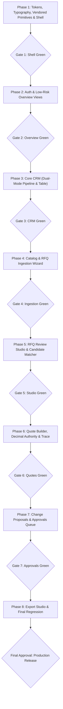

# ForgeFlow × Sakani Redesign Implementation Roadmap

> **Status:** Reviewed for Pre-Approval Consistency  
> **Investigation Date:** October 2026  
> **Scope:** Phased Migration Sequence, Approval Gates, Financial Invariants, and Testable Verification  

---

## 1. Phased Implementation Plan

---

### Phase 1: Tokens, Typography, Vendored Primitives & Shell
- **Scope**: [`frontend/app/layout.tsx`](file:///home/satjeet/Desktop/CRM/frontend/app/layout.tsx), [`frontend/app/globals.css`](file:///home/satjeet/Desktop/CRM/frontend/app/globals.css), [`components/layout/`](file:///home/satjeet/Desktop/CRM/frontend/components/layout/), [`frontend/components/sakani/`](file:///home/satjeet/Desktop/CRM/frontend/components/).
- **Actions**:
  1. Vendor essential primitives (`Button`, `Input`, `Select`, `Card`, `Badge`, `Modal`, `Popover`) from `Sakani-design-system/src/components/` into `frontend/components/sakani/` with `"use client"` added to interactive components.
  2. Install `@fontsource-variable/geist` for Geist Sans and Geist Mono typography.
  3. Map canonical Sakani tokens (`--color-neutral-50: #FAFAF9`, `--color-neutral-950: #0F0E0C`, `--color-border-subtle: #E7E5E1`) and chosen primary accent into `frontend/app/globals.css` Tailwind `@theme`.
  4. Author `frontend/components/sakani/sheet.tsx` wrapping Base UI Dialog in Sakani elevation and border tokens.
  5. Refactor application shell to adopt Sakani's 248px/64px collapsible sidebar and mobile slide-over drawer geometry.
- **Invariants Preserved**: Role-based navigation visibility (`sales_rep`, `sales_manager`, `catalog_manager`, `admin`).
- **Acceptance Criteria**:
  - `pnpm run build` succeeds with 0 TypeScript and 0 Next.js App Router RSC errors.
  - `pnpm run lint` passes with 0 errors.
  - Sidebar expands to 248px, collapses to icon-rail (64px), and opens as a mobile drawer at viewport $\le 760\text{px}$.
  - Dark mode (`.dark`) toggles cleanly without layout shifts or text contrast regressions.
- **Approval Gate**: Human review of application shell across desktop (1440px), tablet (768px), and mobile (390px) viewports.

---

### Phase 2: Authentication & Low-Risk Overview Views
- **Scope**: `/login`, `/app/dashboard`, `/app/activity`.
- **Intended Visual Outcome**: Polished `LoginBlock` layout with quick synthetic demo role selector, executive KPI `StatCard`s, stage distribution chart, and `ActivityFeed` audit timeline.
- **Invariants Preserved**: Stateful HTTP-only session cookies, CSRF protection middleware, live `/crm/dashboard/summary` aggregation queries.
- **Acceptance Criteria**:
  - Login form submits credentials, receives session cookies, and redirects to `/app/dashboard`.
  - Demo role switcher populates valid synthetic credentials.
  - Axe-core accessibility checks report 0 violations on `/login`, `/app/dashboard`, and `/app/activity`.
  - Recharts stage distribution chart renders with canonical chart tokens (`--color-chart-1`..`6`).

---

### Phase 3: Core CRM Entities & Pipeline Kanban
- **Scope**: `/app/accounts`, `/app/accounts/[accountId]`, `/app/contacts`, `/app/opportunities`, `/app/tasks`.
- **Intended Visual Outcome**: Skin existing dual-mode `PipelineBoard` and `OpportunityTable` using Sakani cards and table classes; search toolbars with filter chips.
- **Invariants Preserved**:
  - **Dual-Mode Opportunity View**: Retain existing `[ Pipeline | Table ]` view switcher in `opportunities/page.tsx`.
  - **Server-Driven Pagination**: Keep TanStack React Query pagination and URL bookmarking across all table views.
  - **Stage Transition Governance**: Fast-path column transitions must open `StageTransitionDialog` requiring validation data (`actual_close_date` on won, `closed_reason` on lost); `ReopenDialog` on terminal deals.
  - **Primary Contact Invariant**: Unique primary contact per account with atomic demotion.
- **Acceptance Criteria**:
  - Toggling between Pipeline and Table views retains active filters and search queries.
  - Moving deals across stages strictly opens the validation dialog before mutation dispatch.
  - All existing Playwright CRM tests (`crm.spec.ts`) pass without modification.

---

### Phase 4: Industrial Catalog & RFQ Ingestion Wizard
- **Scope**: `/app/catalog`, `/app/rfqs`, `/app/rfqs/new`.
- **Intended Visual Outcome**: Dense catalog table with stock status badges and SKU alias chips; 2-step RFQ CSV dropzone wizard.
- **Invariants Preserved**:
  - **RBAC Cost Masking**: `unit_cost` and margins strictly omitted from server response and UI for `sales_rep` sessions (`canViewCost === false`).
  - 5MB CSV upload validation, column mapping validation, duplicate RFQ reference detection.
- **Acceptance Criteria**:
  - Catalog cost and margin columns are completely absent from DOM for `sales_rep` logins.
  - RFQ CSV ingestion wizard maps required columns and creates pending RFQs with correct line items.

---

### Phase 5: RFQ Review Studio & Candidate Matcher
- **Scope**: `/app/rfqs/[rfqId]`.
- **Intended Visual Outcome**: Diagnostic counter summary cards, bulk exact match action bar, slide-over candidate matching drawer (`SakaniSheet`).
- **Invariants Preserved**:
  - Matching thresholds ($K=5, T_{min}=0.30, T_{propose}=0.60$, candidate threshold $0.75$).
  - Quote-readiness gate: "Create Quotation" action remains disabled until all mandatory RFQ lines are reviewed and mapped.
- **Acceptance Criteria**:
  - Candidate match drawer opens smoothly, showing part candidates with confidence badges.
  - Acceptance, rejection, and manual override mutations persist to backend cleanly.
  - Playwright RFQ tests (`rfq.spec.ts`) remain green.

---

### Phase 6: Quote Builder, Calculation Authority & Trace Inspector
- **Scope**: `/app/quotes`, `/app/quotes/[quoteId]`.
- **Intended Visual Outcome**: Quote header with revision history pills, interactive line items table, financial totals summary card, slide-over calculation trace drawer.
- **Invariants Preserved**:
  - **Sole Authority of Python Decimal**: Backend `backend/app/domain/quotes/calculator.py` is the exclusive source of truth for all financial totals, discounts, taxes, rounding (`ROUND_HALF_UP`), and trace hashes (`trace_hash`).
  - **Validated String Inputs**: Form inputs store and transmit line numbers as validated strings (`quantity: string`, `unit_price: string`, etc.). No floating-point conversions prior to transmission.
  - **Non-Authoritative Client Previews**: Client-side totals calculation (`useMemo`) is strictly an unsaved typing preview and never persisted as truth.
  - Presentation mode cost and margin masking for client-facing displays.
- **Acceptance Criteria**:
  - Python calculation tests (`pytest backend/tests/unit/test_quote_domain.py`) pass 100%.
  - Saving quote draft transmits raw strings and updates authoritative totals from backend response.
  - Calculation trace inspector opens in `SakaniSheet` and displays 5-level formula tree in Geist Mono.

---

### Phase 7: Review-Before-Write Change Proposals & Approvals
- **Scope**: `/app/approvals`, `QuoteProposalsSection`, `ProposalReviewSheet`.
- **Intended Visual Outcome**: Approvals queue table with status filters; proposal diff review drawer with margin delta chips and maker-checker warning banner.
- **Invariants Preserved**:
  - **Maker-Checker Security Policy**: Proposer cannot approve their own high-discount proposal ($proposer \ne reviewer$).
  - Atomic commit with database row locking (`SELECT ... FOR UPDATE`), mandatory non-empty rejection reason.
- **Acceptance Criteria**:
  - Self-approval attempts are blocked with clear error toast.
  - Manager approval creates Revision $N+1$ atomically.
  - Rejection requires non-empty reason and updates proposal status to rejected.

---

### Phase 8: Document Export Studio, Watermark Governance & Final Hardening
- **Scope**: `QuoteExportSection`, end-to-end regression verification, smoke testing, and build verification.
- **Intended Visual Outcome**: Conspicuous draft watermark warning, watermarked draft PDF downloads, unwatermarked customer PDF/CSV downloads, cryptographic SHA-256 delivery ledger.
- **Invariants Preserved**:
  - Fail-closed export gate (`HTTP 409` on unapproved quotes).
  - Draft preview watermark on unapproved revisions.
  - WeasyPrint SSRF sandbox protection, formula injection sanitization, SHA-256 fingerprint logging.
- **Acceptance Criteria**:
  - `pnpm run build` succeeds cleanly.
  - `pnpm run lint` passes with 0 warnings.
  - Backend tests pass (`uv run pytest`).
  - Playwright E2E suite passes across desktop, tablet, and mobile viewports.
  - `make verify-audit` satisfies 9/9 invariants against PostgreSQL.

---

## 2. Validation & Testable Verification Plan

1. **Automated Test Gates**:
   - `pnpm run build`: Verifies TypeScript compilation and Next.js App Router RSC bundle safety.
   - `pnpm run lint`: Verifies ESLint rules and syntax.
   - `pytest backend/tests/unit/test_quote_domain.py`: Guarantees zero regression to `ROUND_HALF_UP` Decimal financial formulas.
2. **End-to-End Playwright Verification**:
   - Run existing E2E specs (`crm.spec.ts`, `rfq.spec.ts`, `quote.spec.ts`, `proposal.spec.ts`, `export.spec.ts`) across 1440×900, 1024×768, and 390×844 viewports.
3. **Accessibility (WCAG 2.1 AA) Monitoring**:
   - Execute Playwright Axe-core checks on all redesigned routes, verifying color contrast ($\ge 4.5:1$ for body text), keyboard tab order, and focus ring visibility.
4. **Relational & Cryptographic Invariant Diagnostics**:
   - Execute `make verify-audit` to verify relational integrity, proposal commit pointers, and delivery checksums.
